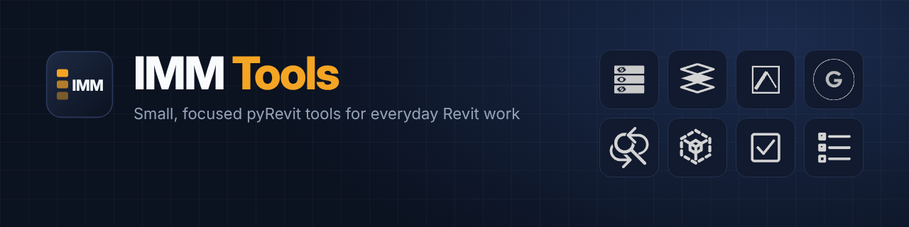

<p align="center"></p>
<p align="center">


<a href="LICENSE"></a>


</p>

**IMM Tools** adds an **IMM** tab to the Revit ribbon with small, focused tools for the jobs that
eat time every day: taming imported DWGs, cleaning up grid bubbles, driving the section box, and
switching view visibility without opening Visibility/Graphics again and again.

Every button has a hover tooltip that explains what it does and how to use it, so you can learn
the tools from inside Revit.

> [!NOTE]
> IMM Tools is a work in progress. Tools are added and refined as they are tested on real projects.

## Contents

- [Tools](#tools)
- [Install](#install)
- [Update and uninstall](#update-and-uninstall)
- [Made with AI](#made-with-ai)
- [Feedback](#feedback)
- [License](#license)

## Tools

### CAD

Control imported and linked DWG files without leaving the view.

| | Tool | What it does |
|:-:|---|---|
| <picture><source media="(prefers-color-scheme: dark)" srcset="IMM.tab/CAD.panel/DWG%20Tools.stack/DWG%20Layer%20Visibility.pushbutton/icon.dark.png"></picture> | **DWG Layer Visibility** | Show or hide individual DWG layers in the current, selected or all views, with search and reset. |
| <picture><source media="(prefers-color-scheme: dark)" srcset="IMM.tab/CAD.panel/DWG%20Isolate.stack/IMM%20Isolate%20Layer.pushbutton/icon.dark.png"></picture> | **Isolate DWG Layer** | Click a line to keep its layer and hide every other layer of that DWG in the active view. Ctrl+click keeps several. |
| <picture><source media="(prefers-color-scheme: dark)" srcset="IMM.tab/CAD.panel/DWG%20Isolate.stack/IMM%20Reset%20Isolate.pushbutton/icon.dark.png"></picture> | **Reset Isolate** | Bring back the layers hidden by Isolate, for one DWG or all of them. |
| <picture><source media="(prefers-color-scheme: dark)" srcset="IMM.tab/CAD.panel/DWG%20Style.stack/IMM%20DWG%20Style.pushbutton/icon.dark.png"></picture> | **DWG Style** | Give a whole DWG one line color and line weight in the active view. The DWG file is untouched. |
| <picture><source media="(prefers-color-scheme: dark)" srcset="IMM.tab/CAD.panel/DWG%20Style.stack/IMM%20DWG%20Style_Reset.pushbutton/icon.dark.png"></picture> | **DWG Style Reset** | Clear those color and weight overrides. |
| <picture><source media="(prefers-color-scheme: dark)" srcset="IMM.tab/CAD.panel/DWG%20Tools.stack/IMM%20Draw%20Layer%20Selected.pushbutton/icon.dark.png"></picture> | **Draw Layer (Selected)** | Switch selected DWGs between Background and Foreground. |
| <picture><source media="(prefers-color-scheme: dark)" srcset="IMM.tab/CAD.panel/DWG%20Tools.stack/IMM%20Draw%20Layer%20All.pushbutton/icon.dark.png"></picture> | **Draw Layer (All)** | Switch every DWG in the file between Background and Foreground in one click. |

### Modeling

Grid and level housekeeping across many views.

| | Tool | What it does |
|:-:|---|---|
| <picture><source media="(prefers-color-scheme: dark)" srcset="IMM.tab/Modeling.panel/Bubble%20Control.pushbutton/icon.dark.png"></picture> | **Bubble Control** | Pick which grid and level bubbles show in many views at once from a visual plan/section diagram, and align their ends. |

### Modify

Bulk edits to element data.

| | Tool | What it does |
|:-:|---|---|
| <picture><source media="(prefers-color-scheme: dark)" srcset="IMM.tab/Modify.panel/Find%20%26%20Replace.pushbutton/icon.dark.png"></picture> | **Find & Replace** | Find and replace text in any parameter, with prefix/suffix, match case and a before/after preview. |

### Section Box

A faster section box for 3D views.

| | Tool | What it does |
|:-:|---|---|
| <picture><source media="(prefers-color-scheme: dark)" srcset="IMM.tab/Section%20Box.panel/Box.stack/Toggle.pushbutton/icon.dark.png"></picture> | **Toggle** | Turn the section box on or off and remember its size. |
| <picture><source media="(prefers-color-scheme: dark)" srcset="IMM.tab/Section%20Box.panel/Box.stack/Create.pushbutton/icon.dark.png"></picture> | **Create** | Box the selected elements with an offset, aligned to the element or to the project axes. |
| <picture><source media="(prefers-color-scheme: dark)" srcset="IMM.tab/Section%20Box.panel/Box.stack/Settings.pushbutton/icon.dark.png"></picture> | **Settings** | Set the offset, the grow/shrink step and the orientation mode. |
| <picture><source media="(prefers-color-scheme: dark)" srcset="IMM.tab/Section%20Box.panel/Resize.stack/Grow.pushbutton/icon.dark.png"></picture> | **Grow** | Enlarge the box on all sides by one step. |
| <picture><source media="(prefers-color-scheme: dark)" srcset="IMM.tab/Section%20Box.panel/Resize.stack/Shrink.pushbutton/icon.dark.png"></picture> | **Shrink** | Shrink the box on all sides by one step. |

### View

Saved Visibility/Graphics presets and quick visibility switches.

| | Tool | What it does |
|:-:|---|---|
| <picture><source media="(prefers-color-scheme: dark)" srcset="IMM.tab/View.panel/VV.stack/IMM%20VV%20Apply.pushbutton/icon.dark.png"></picture> | **Apply VV** | Apply your saved 2D or 3D Visibility/Graphics set to the active view. |
| <picture><source media="(prefers-color-scheme: dark)" srcset="IMM.tab/View.panel/VV.stack/IMM%20VV%20Temp.pushbutton/icon.dark.png"></picture> | **Temp. VV** | Work in Revit's temporary view mode so every VV change is undone when you exit. |
| <picture><source media="(prefers-color-scheme: dark)" srcset="IMM.tab/View.panel/VV.stack/IMM%20VV%20Settings.pulldown/icon.dark.png"></picture> | **VV Settings** | Save the active view as your 2D or 3D set, or copy it into the matching set. |
| <picture><source media="(prefers-color-scheme: dark)" srcset="IMM.tab/View.panel/Display.stack/IMM%20VV%20Categories.pushbutton/icon.dark.png"></picture> | **Categories** | A searchable drop-down of model categories with check boxes, applied as you click. |
| <picture><source media="(prefers-color-scheme: dark)" srcset="IMM.tab/View.panel/Display.stack/IMM%20VV%20Annotations.pushbutton/icon.dark.png"></picture> | **Annotations** | Show or hide every annotation category in one click. |

## Install

**With the pyRevit CLI** (needs internet access to GitHub):

```
pyrevit extend ui IMM https://github.com/sliver301/IMM-Tools.git
```

**Manually:**

1. Download this repository (**Code > Download ZIP**) and unzip it.
2. Rename the unzipped folder to `IMM.extension`.
3. Put it in a folder of your choice, for example `%APPDATA%\pyRevit\Extensions\`.
4. In Revit, open **pyRevit > Settings > Custom Extension Directories**, add the folder that
   *contains* `IMM.extension`, save, and reload pyRevit.

The **IMM** tab appears on the ribbon.

### Requirements

- Autodesk Revit
- [pyRevit](https://github.com/pyrevitlabs/pyRevit), a recent version

## Update and uninstall

- **Update:** replace the `IMM.extension` folder with the new version, then fully close and reopen Revit. A plain pyRevit reload can keep old
  button names after tools are renamed.
- **Uninstall:** delete the `IMM.extension` folder and restart Revit.

Your personal settings are stored in pyRevit's config and in the extension's `data` folder.

## Made with AI

IMM Tools is built in close collaboration with an AI assistant,
[Claude](https://www.anthropic.com/claude) by Anthropic.

- **The ideas, the workflow and the testing are human.** Each tool starts from a real, repeated task
  in Revit work, and every tool is tried in Revit on real projects before it is released.
- **Most of the code, the icons and this README were written by Claude**, guided by those
  requirements, then reviewed and corrected through test-and-fix rounds in Revit.
- **AI-written code can still have bugs.** Try new tools on a copy of your model first, and please
  report anything odd (see [Feedback](#feedback)).

This is shared openly so others can see what an engineer plus an AI assistant can build for their own
daily workflow.

## Feedback

Found a bug or have an idea for a tool? Open an
[issue](https://github.com/sliver301/IMM-Tools/issues) with the tool name, your Revit version and,
if possible, the error text from the pyRevit output window.

## License

[MIT](LICENSE) © 2026 Islam Abohadia
